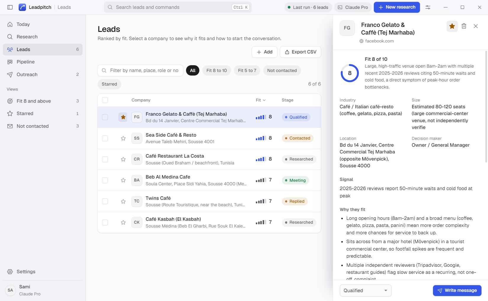
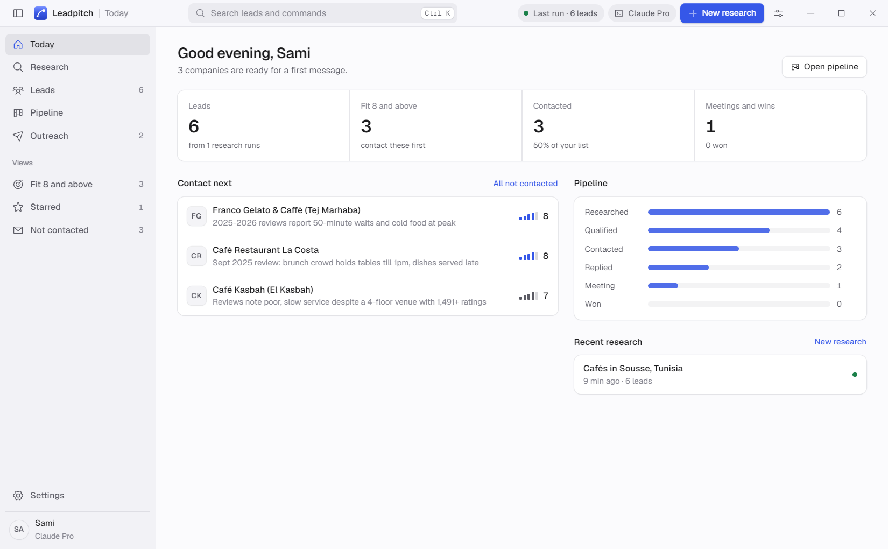
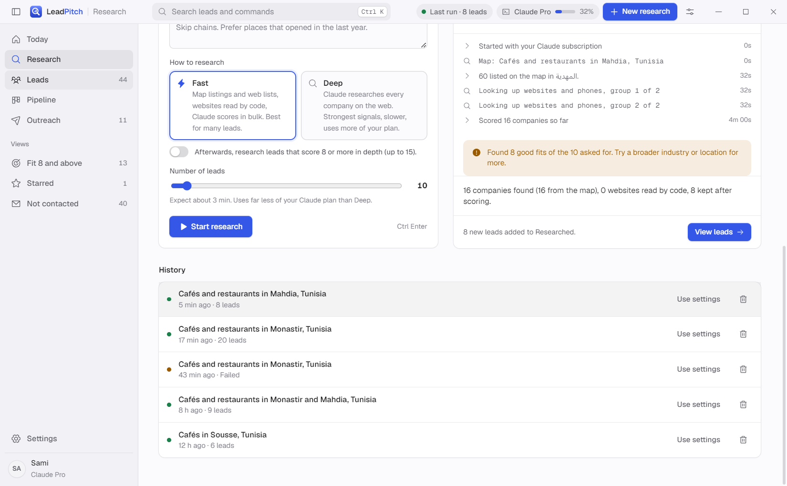
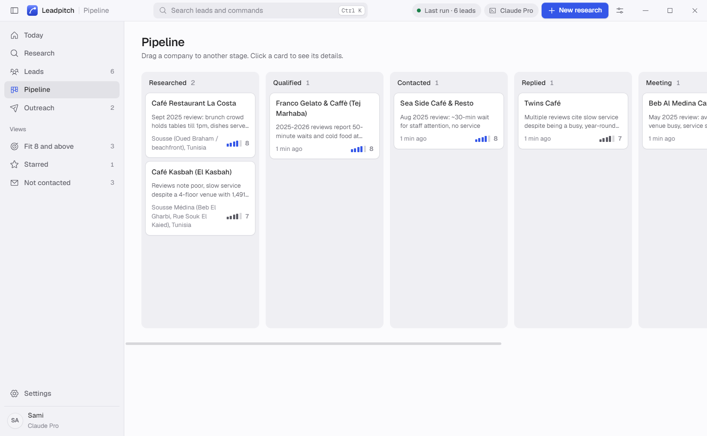
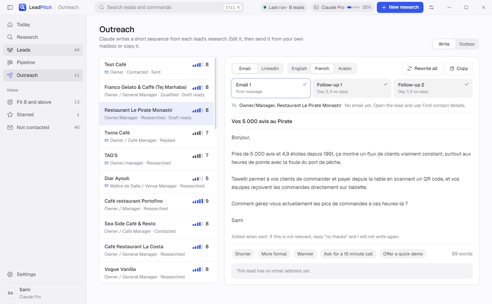
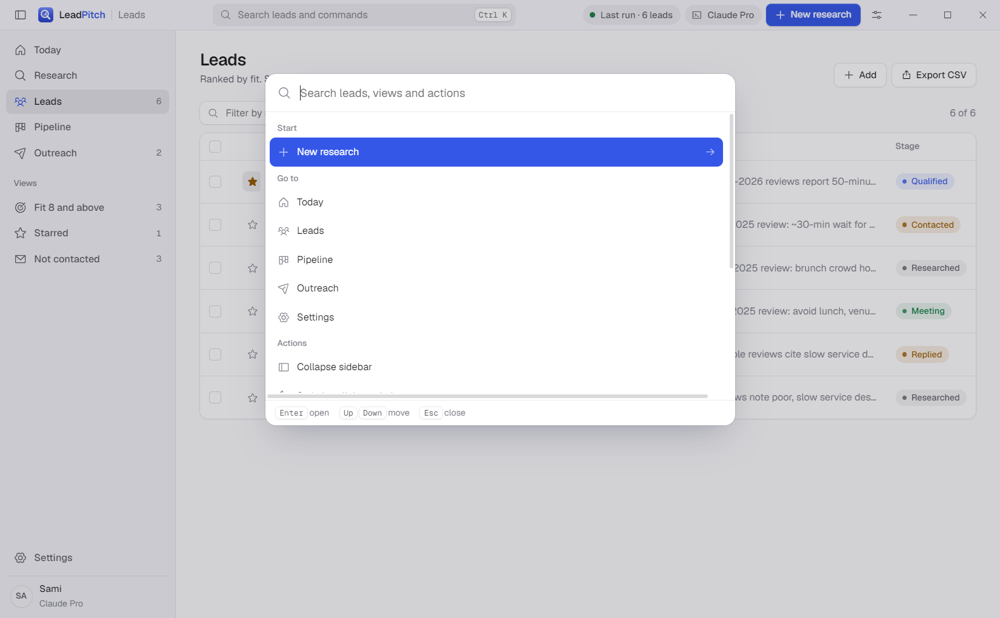
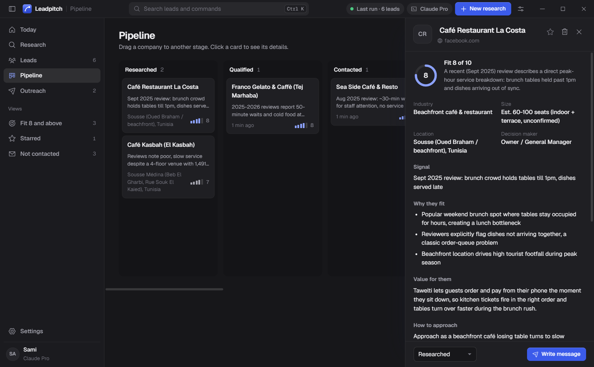

<p align="center">
  <picture>
    <source media="(prefers-color-scheme: dark)" srcset="docs/lockup-dark.png">
    
  </picture>
</p>

<p align="center">
  A desktop app that finds companies likely to buy what you sell, scores each one from 1 to 10,
  and helps you reach them. Research runs through Claude Code on your computer, using your own
  Claude subscription.
</p>



## What it does

You describe your product and who buys it. LeadPitch finds companies, reads what they publish,
and Claude scores each one from 1 to 10 with the reason, who to contact, how to approach them,
two opening lines and the published contact details (email, phone, contact page, website,
social pages). Then it writes a short email sequence and sends it from your own mailbox, stops
follow-ups when someone replies, and moves the lead along the pipeline.

Nothing paid is needed besides your Claude subscription.

### Two research engines

| | Fast (default) | Deep |
| --- | --- | --- |
| Finds companies | OpenStreetMap listings (free, no key), plus short Claude web-search lists when the map has too few | Claude researches the web for each company |
| Reads websites | Plain code: emails, phones, people, social links, tech stack | Claude reads pages |
| Scores | Claude, 20 companies per call, no web tools | Claude, per company |
| Best for | Many leads, local businesses | Fewer leads, strongest buying signals |

Fast runs can also research the top fits (score 8 or more) in depth afterwards, and any single
lead can be researched in depth from its panel. In tests, 20 cafés in Monastir took under
8 minutes with the map service down, and 10 in Mahdia took 4 minutes, using roughly 5,000 to
6,000 Claude tokens per lead. Up to 100 leads per run; a small panel in the corner shows progress
while you work elsewhere, and the title bar shows how much of your Claude usage window is used.

### Outreach from your mailbox

- Connect Gmail, Outlook or any SMTP and IMAP mailbox with an app password, stored encrypted.
- Claude writes a first email, two follow-ups and a LinkedIn note, in English, French or Arabic.
- Nothing is sent until you approve it. Then a daily limit, sending hours, a pause between
  messages, an opt-out line, a do-not-contact list, and a check that the recipient domain accepts
  mail all apply.
- Follow-ups go in the same thread and are cancelled when the lead replies. Replies move the lead
  to Replied; bounced addresses are marked do-not-contact.
- Meeting briefs with likely objections, written from the lead research.
- CSV export, including a format Instantly and Smartlead import without column mapping.

It builds on the [Lead Research Assistant](https://github.com/ComposioHQ/awesome-claude-skills/tree/master/lead-research-assistant)
skill (ComposioHQ, Apache 2.0). Website extraction ideas and sales templates are adapted from
[ai-sales-team-claude](https://github.com/zubair-trabzada/ai-sales-team-claude) (MIT).

## Screens

**Today.** Who to contact next, follow-ups that are due, and how the pipeline is moving.



**Research.** Describe what you sell and who buys it. The run panel shows each step live:
every search, every page Claude reads, and how many leads it has found. Runs over 15 leads go
in batches, and leads are saved after each batch.



**Pipeline.** Drag companies from Researched to Won.



**Outreach.** Claude writes a three-email sequence and a LinkedIn note from each lead's research,
in English, French or Arabic. Edit it, then approve it to send from your own mailbox, or copy it.
The Outbox shows what is scheduled, sent, failed or cancelled.



**Search and dark mode.** Ctrl K finds any lead, view or action. The app follows your
system theme, or you can pick one.





The leads in these screenshots are real public cafés in Sousse, Tunisia, found during a test run.

## How it connects to Claude

LeadPitch does not call the Anthropic API itself. It starts your installed Claude Code
(`claude -p --output-format stream-json`), so research uses whichever account Claude Code is
signed in with:

- **Claude subscription** (default): sign in once with `claude auth login`, or use the Sign in
  button in Settings, which opens a terminal for it.
- **API key**: paste a key in Settings. It is encrypted with the system keychain
  (Electron `safeStorage`) and passed to Claude Code only for that run.

Subscription login is meant for your own use. If you give LeadPitch to other people, they
should use their own Claude Code login or API key. A product that offers Claude subscription
login to its users needs Anthropic's approval.

## Run it

Requires Node.js 20 or later and Claude Code 2.1 or later on the PATH (or set its location
in Settings).

```bash
npm install
npm run dev        # development, hot reload
npm run build      # production build into out/
npx electron .     # run the production build
npm run package    # Windows installer into dist/
npm run icons      # regenerate the app icons and the README logo from the mark
```

## What is where

| Path | What it does |
| --- | --- |
| `src/main/index.ts` | Frameless window, IPC, CSV export |
| `src/main/research.ts` | Starts runs; the Deep engine in parallel batches |
| `src/main/fast.ts` | The Fast engine: find, read, score, optional deep research |
| `src/main/sources/osm.ts` | OpenStreetMap search (Nominatim and Overpass) |
| `src/main/sources/website.ts` | Reads company websites with plain HTTP |
| `src/main/mail.ts` | Sending queue, guards, follow-ups, reply and bounce tracking |
| `src/main/usage.ts` | Claude usage in 5-hour windows |
| `src/main/claude.ts` | Finds Claude Code, sign-in status, one-shot prompts |
| `src/main/prompts.ts` | Skill text plus the LeadPitch output contract, draft prompts |
| `src/main/store.ts` | Local JSON store in the app data folder, atomic writes |
| `src/renderer/src` | React interface: title bar, sidebar, views, command palette |
| `resources/skill/SKILL.md` | The bundled skill |

Data stays on your computer, in `%APPDATA%/LeadPitch/leadpitch.json`. Each run keeps its
prompt and `leads.json` in `%APPDATA%/LeadPitch/runs/<id>/`.

## Keyboard

| Keys | Action |
| --- | --- |
| Ctrl K | Search leads and commands |
| Ctrl N | New research |
| Ctrl Enter | Start research from the form |
| Ctrl 1 to 6 | Switch views |
| Ctrl \ | Collapse or expand the sidebar |
| J and K | Move through leads |
| S | Star the open lead |
| X | Select the open lead |
| Esc | Close the open panel |

## Credits

The lead research method comes from the Lead Research Assistant skill by
[ComposioHQ](https://github.com/ComposioHQ/awesome-claude-skills), licensed under Apache 2.0.
A copy ships in `resources/skill/SKILL.md`.
